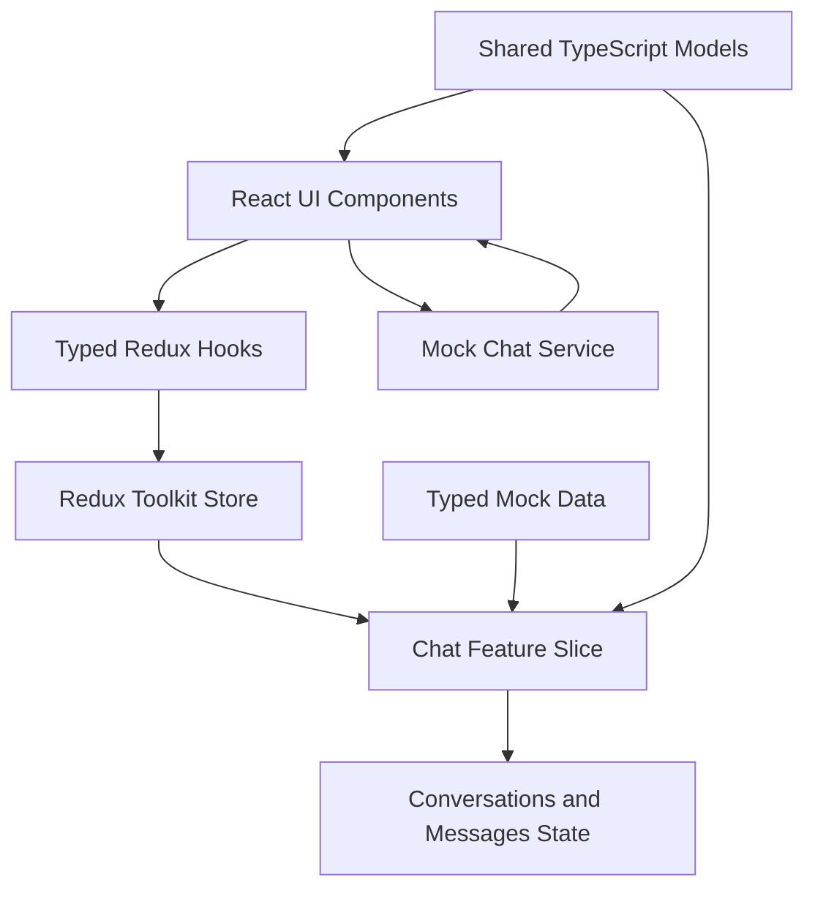

# QuantumChat architecture

The React components render the current state and dispatch user actions. The chat feature slice owns conversation/message updates. Mock services simulate loading and incoming activity. Shared TypeScript interfaces define the message, member, and conversation contracts.
